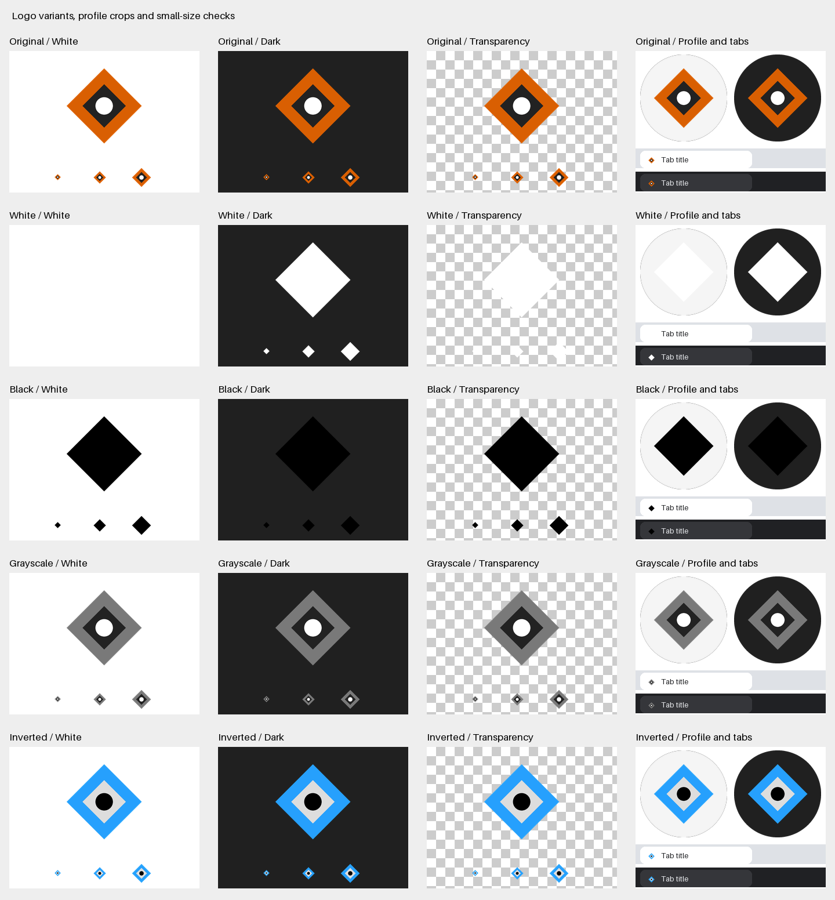

<!-- TNDS-HEADER:BEGIN -->
<div align="center">
  <h1>NorthMark</h1>
  <h3>One clean master in, a digital kit and print-ready transfers out.</h3>
  
  <br /><br />
  <a href="#stack"></a>
  <a href="https://github.com/True-North-Data-Strategies/NorthMark/actions/workflows/tests.yml"></a>
  <a href="#contact"></a>
</div>
<!-- TNDS-HEADER:END -->

## Contents

[What this is](#what-this-is) | [Quick start](#quick-start) | [DTF quick start](#dtf-quick-start) |
[Gang sheets](#gang-sheets) | [Keep your artwork private](#keep-your-artwork-private) |
[Color versions](#color-versions) | [Background removal](#background-removal) |
[Config reference](#config-reference) | [One master does it all](#one-master-does-it-all-when-it-does-and-when-it-doesnt) |
[SVG originals](#svg-originals) | [What is in a kit](#what-is-in-a-kit) | [Export sizes](#export-sizes) |
[Safe reruns](#safe-reruns-and-other-folders) | [Development](#development-and-installation) | [Manuals](#manuals)

## What this is

NorthMark (formerly Create Logos All Sizes) turns source artwork into correctly proportioned PNGs, lossless WebP, color variants,
browser and app icons, a web drop-in folder, previews and a ZIP you can hand to someone
else. Then take the same master to print: 300 DPI direct-to-film (DTF) transfer files at
exact placement sizes, garment mockups, an order sheet, a press card, and gang sheets
packed onto 22 inch rolls with a cut list. Runs locally. No account, upload service or
AI is required.

| Problem it removes | How |
| --- | --- |
| Hand-exporting the same logo at fifteen sizes for every new brand | One command writes every size, variant and icon |
| Round logos coming out as ovals or clipped | Fit, never crop or stretch; optional trim to the art first |
| A cream or white halo around a logo that was "transparent" | Soft-edge matting with color decontamination |
| A white box behind a logo that should be transparent | Explicit or measured background removal |
| No real dark-background version of a logo | Named color-map variants, such as `reverse` |
| Guessing the size to type into a printer's custom-size box | Exact inches to two decimals, per placement |
| Ordering a transfer that prints blurry | An honest source-DPI verdict before any resampling |
| A rerun quietly overwriting the last good set of files | Atomic publish with dated backups and a process lock |



*The kit preview for the generated demo mark. Each color version sits on white, dark and
transparent backgrounds, then in circular profile crops and light and dark browser tabs.
The empty white-on-white and black-on-dark cells are the point: they show which version
not to use where.*

## Quick start

Requires Python 3.10 or newer.

```sh
python3 -m venv .venv
source .venv/bin/activate
python -m pip install -r requirements.txt
mkdir -p local-assets/input
```

On Windows, use `python` instead of `python3` and activate with
`.venv\Scripts\activate`. You can create `local-assets/input` in Explorer.

Put your original images in `local-assets/input`, then run:

```sh
python make_logo_sizes.py
```

Each image gets its own folder and ZIP under `local-assets/exports`. The default keeps
the original colors, fits the complete source inside each canvas, and adds 8% padding
per side. Nothing is cropped or stretched. Existing output is refused.

To try the tool without your own artwork:

```sh
python examples/make_demo.py
python make_logo_sizes.py local-assets/input/demo-mark.png --variants all
```

The example is a generic geometric mark generated locally; no brand artwork ships with
this repository. The installed command `logo-sizes` and `python -m northmark` do the
same thing as the wrapper script. Every v3 invocation still works unchanged; `kit` is
its explicit name now that `dtf` and `gang` exist.

## DTF quick start

```sh
python make_logo_sizes.py dtf local-assets/input/mark.png --placement full-back
python make_logo_sizes.py dtf --brand local-assets/brands/my-brand.yaml --order local-assets/orders/2026-10-18-tees.yaml
python make_logo_sizes.py dtf --list-placements
```

For each design, placement and variant the tool trims the art to its bounding box, fits
it inside the vendor's average placement box while keeping the aspect ratio, and reports
the exact width and height in inches. That pair of numbers is what you type into the
vendor's custom-size box. The PNG has exactly that many pixels at 300 DPI and carries a
300 DPI tag. It is never mirrored.

| Output | Where | What it is for |
| --- | --- | --- |
| `dtf/<audience>/<placement>/<variant>/<design>-<placement>-<W>x<H>in.png` | per design | The file to upload, 300 DPI, hardened alpha |
| `dtf/mockups/<placement>-<variant>-on-<garment>.png` | per design | Flat garment swatches at shirt scale; the only proof you get |
| `dtf/order-sheet.csv` | per design | One row per transfer: inches, pixels, source DPI, warnings, file, qty |
| `dtf/press-card.pdf` or `.png` | per design | Sizes, positions, variant per garment color, vendor press settings |
| `dtf/dtf.json` | per design | Everything above as data, with checksums |

The resolution verdict is the honest part. Source pixels divided by print inches is the
real resolution, measured before any resampling. At or above 300 DPI is fine. Below 300
warns. Below 150 refuses the file unless you pass `--allow-low-dpi`, and the summary
then says the art was enlarged and gives the true source DPI. Setting a 300 DPI tag on
too few pixels fixes nothing, so the tool never pretends otherwise. Every verdict comes
with the pixel size that would reach 300.

Other checks on every transfer: alpha is thresholded to opaque or clear with at most a
one pixel soft edge (`--no-harden` keeps soft alpha, `--choke 1` trims fringe), strokes
thinner than about 0.5 mm are estimated and flagged as industry guidance, and each
variant's edge color is compared with each garment color so the summary can say, for
example, "navy shirt: use reverse". Placements, average sizes, ranges, positions,
garment swatches, press settings and bulk tiers all live in
[`northmark/data/ninja-placements.yaml`](northmark/data/ninja-placements.yaml) with
the date they were read. Where the vendor's pages disagree, both values are recorded and
the safer one is used. Confirm current specs before ordering.

## Gang sheets

```sh
python make_logo_sizes.py gang local-assets/orders/2026-10-18-gang.yaml
python make_logo_sizes.py gang local-assets/orders/2026-10-18-gang.yaml --dry-run
python make_logo_sizes.py gang job.csv --no-rotate --no-pdf
```

A job file lists designs or PNG files with sizes and quantities; see
[`examples/gang-job.example.yaml`](examples/gang-job.example.yaml) and the CSV template in
[`examples/templates/gang-job.csv`](examples/templates/gang-job.csv). Items that name a
design, placement and variant pick up the matching DTF output automatically.

| Output under `exports/gang-sheets/<job>/` | What it is |
| --- | --- |
| `sheet-22x<L>.png` | The sheet at 300 DPI, written in horizontal bands so long sheets stay in bounded memory |
| `sheet-22x<L>.pdf` | The same sheet as a PDF; each transfer image is embedded once and placed per copy (needs `[print]`) |
| `layout.json` | Every position in inches, sheet lengths, utilization, warnings, optional cost compare |
| `cut-list.csv` | One row per placed copy, with a matching template in `examples/templates/` |
| `preview.png` | Downscaled sheets with labeled boxes |

Packing is deterministic shelf packing on the configured width, with a 0.25 inch gap
(the lowest published industry minimum) and a 0.5 inch edge margin (a conservative
default; 0.25 is the published minimum) and 90 degree rotation allowed. The tool picks
the shortest configured standard length that fits, or splits across sheets, and prints
the utilization. Files over the 50 MB upload ceiling get a warning. Enter the vendor's
current prices in the job file and the summary compares cost per transfer for gang
sheets against by-size orders with the bulk tiers.

Ninja Transfers accepts an uploaded gang sheet only when it is fully vector. The sheet
PNG and PDF this tool writes are raster, so for Ninja the workflow is: upload the 300 DPI
transfer PNGs from each design's `dtf/` folder into Ninja's online gang sheet builder and
reproduce the layout from `layout.json`, or let Auto Build place them. The rendered sheet
is your cut plan, and the file to send to printers that accept raster sheets. The run
summary prints this rule, with the dates the sources were read.

## Keep your artwork private

```text
NorthMark/
  make_logo_sizes.py       command you run
  northmark/               public program code and vendor data files
  tests/                   tests generate their own temporary artwork
  examples/                generic example generator, example configs and CSV templates
  docs/                    manuals, plus docs/images/ with the only tracked images
  local-assets/            IGNORED BY GIT: keep all your own material here
    input/                 original artwork
    brands/<brand>.yaml    one configuration per brand
    orders/                order files and gang-sheet jobs
    exports/<brand>/       kits, dtf/ outputs and previews
    exports/gang-sheets/   packed sheets
    exports/.backups/      previous outputs kept by --overwrite
    private-terms.txt      names that must never appear in tracked YAML or CSV
    archive/               old files or other private material
```

The entire `local-assets/` folder is ignored, including brand files, orders and
exports. Common artwork and archive extensions are also ignored outside that folder.
Git ignore is not encryption or access control, and `git add -f` can bypass it. Never
force-add your artwork to a public repository.

Before publishing changes, run:

```sh
python tools/check_public_files.py
```

This checks tracked filenames, obvious credential patterns, and, when
`local-assets/private-terms.txt` exists, rejects any tracked YAML or CSV that mentions a
listed term without echoing the term. Review your staged changes too; it cannot
recognize every private detail inside an arbitrary text file. The Python package
includes only `northmark` and its data files, never `local-assets`.

## Color versions

```sh
python make_logo_sizes.py --variants all
python make_logo_sizes.py --variants original white black
```

| Version | Result |
| --- | --- |
| `original` | Original colors and existing transparency |
| `white` | White artwork with the source alpha channel |
| `black` | Black artwork with the source alpha channel |
| `grayscale` | Neutral shades with the source alpha channel |
| `inverted` | Every RGB color negated; transparency stays the same |
| any map name | A named recolor from the brand file, such as `reverse` or `one-color` |

White and black versions need transparent source artwork; the tool refuses an opaque
source for those so it never produces a solid rectangle. A map variant is the real
answer for a reverse version: it recolors chosen colors and clears others, with a
tolerance and an optional feather per entry, and leaves everything else alone. A logo
whose enclosed background color stays opaque after edge-mode background removal becomes
a usable dark-shirt version by mapping its outline to white and that enclosed color to
transparent.

## Background removal

```sh
python make_logo_sizes.py logo.png --remove-background "#ffffff" --variants all
python make_logo_sizes.py logo.png --remove-background auto
python make_logo_sizes.py logo.png --remove-background "#faf6ee" --tolerance 4 --feather 200
```

| Option | Effect |
| --- | --- |
| `--remove-background COLOR` | Make that flat color transparent; `edge` mode keeps enclosed areas |
| `--remove-background auto` | Measure the border color and its noise, print the values used, then remove it |
| `--tolerance N` | Pixels within N of the color in any channel are fully removed |
| `--feather N` | Alpha ramps over the next N levels and the background color is subtracted from edge pixels |
| `--background-mode all` | Remove every matching pixel, including enclosed details |
| `--trim` | Crop to the artwork bounding box before fitting, so a framed master does not come out small |

A hard cut leaves a one or two pixel ring of blended background color around
anti-aliased art, which shows as a light halo on a dark surface. Feathering fixes it: set
the feather close to the contrast between the art and its background, which is what
`auto` does. Background removal only runs when asked, and the tool never guesses
silently.

## Config reference

A brand file is the template-plus-config way to run the tool: the program is the
template and each brand gets one YAML file. Copy
[`examples/brand.example.yaml`](examples/brand.example.yaml) to
`local-assets/brands/<brand>.yaml`, then:

```sh
python make_logo_sizes.py kit --brand local-assets/brands/my-brand.yaml
python make_logo_sizes.py dtf --brand local-assets/brands/my-brand.yaml
```

| Key | Purpose |
| --- | --- |
| `brand`, `slug` | Display name and output folder name |
| `sources.primary`, `symbol`, `horizontal` | The full logo; a mark for 64 px and under and small DTF placements; banner art |
| `colors` | Named colors used by maps, backgrounds and garments |
| `background` | `color` (a color or `auto`), `mode`, `tolerance`, `feather` |
| `trim` | `enabled` and `threshold` |
| `padding`, `formats`, `variants` | As on the command line; variants may include map names |
| `maps` | Named lists of `{from, to, tolerance, feather}`; `to: transparent` clears |
| `sizes` | `groups`, `presets` and `custom` sizes; omit the block for the standard set |
| `icon_background`, `banner_background` | Opaque fills for maskable icons and for banner sizes |
| `web` | `name`, `short_name`, `theme_color`, `background_color` for the web drop-in files |
| `dtf` | `audience`, `placements`, `variants`, `garments`, `symbol_for`, `overrides` |
| `uvdtf` | Sticker sizes in inches, same 300 DPI rules, no garment mockups |

Paths are relative to the brand file. Every key is validated before any artwork is read,
and unknown keys are errors. With `--brand`, the size, variant and color flags are
refused so there is one source of truth. The user manual lists every key with its
defaults.

## One master does it all: when it does and when it doesn't

| Situation | Verdict |
| --- | --- |
| A clean transparent PNG of at least 2048 px for digital use | Yes. One master covers every kit size |
| A vector SVG master | Yes, for everything. DTF files render at a true 300 DPI and a vector PDF is written |
| A flat-background PNG with anti-aliased edges | Yes, with `--remove-background auto` or a brand `background` block |
| A dark-shirt version of a logo with an enclosed light fill | Yes, with a `reverse` map; the tool cannot invent one from alpha alone |
| A chest-size version of a logo with a tagline or fine detail | Usually not. The thin-stroke check will say so; supply a `symbol` master |
| A full-back transfer from a raster master under about 3300 px on its long side | No. The DPI verdict fails and names the pixel size you need |
| Navy art on a navy shirt | No file can fix that; the contrast check recommends another variant |

The tool reports every one of these plainly in the run summary and in `kit.json`,
`dtf.json` and the order sheet, so you never have to open an image to find out.

## Horizontal, stacked and symbol artwork

Provide a separate source design for each layout. The tool sizes them; it does not
rearrange lettering, invent a symbol or trace raster artwork into vector paths. A brand
file's `symbol` source is used for sizes of 64 px and under and for the DTF placements
listed in `symbol_for`; its `horizontal` source is used for canvases at least twice as
wide as they are tall. Without a brand file, use custom canvases:

```sh
python make_logo_sizes.py brand-horizontal.png --size header=1200x300
python make_logo_sizes.py brand-symbol.png --group web --variants all
python make_logo_sizes.py --padding 0.12 --no-upscale --formats png webp
```

Custom sizes replace the standard list unless you also select a `--group` or
`--preset`, in which case they are added. `--no-upscale` keeps raster artwork at or
below its source pixel dimensions inside the requested canvas; raster enlargement
otherwise produces a note.

## SVG originals

Install optional SVG support:

```sh
python -m pip install -e ".[svg]"
```

CairoSVG also needs the Cairo system library. On macOS, install it with
`brew install cairo`; on Debian/Ubuntu use `sudo apt-get install libcairo2`. For Windows
setup, see the [CairoSVG installation instructions](https://cairosvg.org/documentation/).
Raster inputs work without CairoSVG or Cairo.

Provide a plain, self-contained SVG with a `viewBox` or numeric pixel width and height.
Path-based artwork is preferable to text that depends on installed fonts. External
resources, embedded images, scripts, entities, imports and `url()` references are
refused; a `<style>` block with plain fill, stroke and font rules is accepted. The
original SVG is copied unchanged to `masters/source.svg` and to `web/favicon.svg`, and a
vector `print/<slug>.pdf` is written. The tool does not create a vector master from a
PNG or JPEG.

## What is in a kit

| Part | Contents |
| --- | --- |
| `<variant>/` | Every selected size as PNG, and WebP if requested |
| `<variant>/app-icons/` | Six-size `favicon.ico`, 192 and 512 regular and maskable icons, Apple touch icon, manifest icon fragment |
| `web/` | Drop-in files for a site root: icons, complete `site.webmanifest`, `head.html`, `favicon.svg` and the Open Graph image when made |
| `print/<slug>.pdf` | Vector PDF, SVG sources only |
| `preview.png`, `preview.html` | White, dark and checkerboard backgrounds, profile circles, tab mocks, 16, 32 and 48 px samples |
| `preview-banners.png` | Each banner size with its safe area outlined |
| `masters/` | The untouched primary (`source.*`), symbol and horizontal originals |
| `GUIDE.txt` | Which files to use and the important limitations |
| `kit.json` | Options, sources with checksums, and every file's size, checksum, variant, preset, purpose and source role |
| `<slug>.zip` | The complete kit, as a sibling file |

Every run ends with a readable summary: each file and its size in KB, a total, every
warning (including per-preset size caps) and every note. Skip parts with `--no-icons`,
`--no-preview` or `--no-zip`.

## Export sizes

Use `--list` for the complete list with sources. The original fifteen sizes are the
standard set and are written by a run with no size flags; the rectangular sizes are
optional and selected explicitly. All of them come from
[`northmark/data/platform-presets.yaml`](northmark/data/platform-presets.yaml) with a
source and the date it was read.

| Group | Sizes in pixels | Default |
| --- | --- | --- |
| `youtube` | Watermark 150, profile 800 | Yes |
| `web` | 16, 32, 180, 192, 512 | Yes |
| `social` | LinkedIn 400, X 400, Facebook 500, Instagram 320 | Yes |
| `docs` | Document 600, email 200, slide 1000 | Yes |
| `master` | 2048 raster derivative | Yes |
| `banners` | YouTube banner 2560x1440 with a 1546x423 safe area and 6 MB cap, X header 1500x500, LinkedIn cover 1128x191 and 4200x700 (conflicting specs, both provided) | No |
| `share` | Open Graph image 1200x630 | No |

```sh
python make_logo_sizes.py --group banners --banner-background "#0f2340"
python make_logo_sizes.py --preset og-image-1200
```

Banner sizes keep the artwork inside the platform's safe area and take an optional
opaque `--banner-background`. These are convenient starting sizes, not current platform
acceptance guarantees.

## Safe reruns and other folders

```sh
python make_logo_sizes.py --dry-run
python make_logo_sizes.py --overwrite
python make_logo_sizes.py -i /path/to/originals -o /path/to/exports
```

`--overwrite` backs up the previous output before publishing the new one, for kits, DTF
folders and gang sheets alike. A kit rebuild keeps the design's existing `dtf/` folder. Failed builds never replace a previous result. Duplicate
output names are caught before any batch writes. Dry runs check paths, names and
options without decoding artwork. A failed source produces a nonzero exit status; other
valid sources still finish.

An output lock prevents two processes from publishing into the same folder at once. The
lock records its process id and host. If that process has exited on the same machine,
the next run reclaims the stale lock itself and says so; the reclaim is a rename, so two
runs that find the same stale lock cannot both proceed. A lock from a live process or
another machine is respected.

## Development and installation

```sh
python -m pip install -e ".[svg,print]"
python -m unittest discover -s tests -v
python tools/check_public_files.py
```

Tests create temporary generic images and exercise real exports, pixels, transparency,
matting, color maps, brand files, DTF sizing and verdicts, gang-sheet packing, backups,
locks, icons, ZIPs and SVG refusal rules. CI runs the suite on Ubuntu, macOS and Windows
for Python 3.10, 3.12 and 3.14, with SVG checks skipped where Cairo is unavailable, then
runs the public-file check. Dependabot keeps the SHA-pinned actions current. Pushing a
`v*` tag builds the wheel and sdist, refuses any private file in the build, and
publishes a GitHub release.

To regenerate the README image after changing the preview:

```sh
python examples/make_demo.py
python make_logo_sizes.py local-assets/input/demo-mark.png --variants all --overwrite
cp local-assets/exports/demo-mark/preview.png docs/images/demo-preview.png
```

## Manuals

| Document | For |
| --- | --- |
| [User manual](docs/USER-MANUAL.md) | Every command, flag, file format and output, with troubleshooting |
| [Developer manual](docs/DEVELOPER-MANUAL.md) | Module map, data files, publishing and locking, tests, releases, security notes |

## License

[MIT](LICENSE) for the software. No personal or client artwork is included. The
software license grants no rights to any source artwork you process.

## Stack

| Layer | Tools |
| --- | --- |
| Runtime | Python 3.10 or newer |
| Image processing | Pillow |
| Configuration | PyYAML, safe loader only |
| Optional SVG rendering and vector PDF | CairoSVG and Cairo (`[svg]`) |
| Optional press card and gang-sheet PDF | reportlab (`[print]`) |
| Checks | Python unittest, GitHub Actions on three operating systems, the public-file check |

<!-- TNDS-FOOTER:BEGIN -->
## Contact

Jacob Johnston | True North Data Strategies LLC, SDVOSB | Colorado Springs, Colorado

jacob@truenorthstrategyops.com | [truenorthstrategyops.com](https://truenorthstrategyops.com) | [pipelinepunks.com](https://pipelinepunks.com)

_Maintained by the TNDS README steward. Last reviewed 2026-10-19._
<!-- TNDS-FOOTER:END -->
